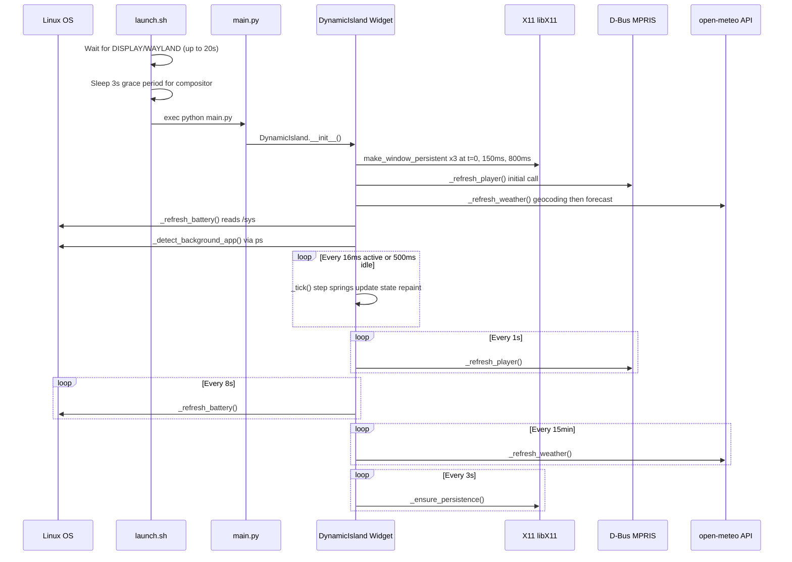

# 🏝️ Project Overhead — Linux Dynamic Island
### Complete Project Documentary

> A frameless, always-on-top, spring-animated desktop overlay for Linux that brings Apple's **Dynamic Island** concept to X11/Wayland environments — with live music, charging, timer, weather, and background-app awareness.

---

## Table of Contents

1. [Project Overview](#1-project-overview)
2. [Tech Stack](#2-tech-stack)
3. [File Structure](#3-file-structure)
4. [Installation & Setup](#4-installation--setup)
5. [Architecture](#5-architecture)
6. [State Machine — All 7 States](#6-state-machine--all-7-states)
7. [Code Deep-Dive](#7-code-deep-dive)
8. [Themes](#8-themes)
9. [How It Works — Runtime Flow](#9-how-it-works--runtime-flow)
10. [Configuration & Persistence](#10-configuration--persistence)
11. [Design Reference Diagrams](#11-design-reference-diagrams)
12. [Known Limitations & Future Work](#12-known-limitations--future-work)

---

## 1. Project Overview

**Project Overhead** is a single-file Python desktop widget that renders a pixel-perfect recreation of Apple's iPhone 15 Pro **Dynamic Island** on any Linux desktop. It lives at the top-center of your primary screen, adapts to activity (music, charging, timers, background apps), and animates via a custom spring-physics engine.

| Property | Value |
|---|---|
| **Language** | Python 3.10+ |
| **GUI Framework** | PyQt6 |
| **Display Targets** | X11 (primary), XWayland |
| **Lines of Code** | ~1,595 |
| **Entry Point** | `main.py` |
| **Launcher** | `launch.sh` |
| **Config Location** | `~/.config/project-overhead/config.json` |
| **Log Location** | `~/.local/share/project-overhead/island.log` |

---

## 2. Tech Stack

### Core Runtime

| Technology | Role |
|---|---|
| **Python 3.10+** | Application language |
| **PyQt6** | Widget rendering, events, timers, D-Bus |
| **PyQt6.QtDBus** | MPRIS media player integration via D-Bus |
| **ctypes** | Raw X11 `libX11.so.6` calls for window management |

### System APIs Used

| API / Interface | Purpose |
|---|---|
| `X11 / libX11.so.6` | Set `_NET_WM_STATE_STICKY`, `_NET_WM_WINDOW_TYPE_DOCK`, `_NET_WM_STATE_ABOVE` — makes the widget un-minimizable and visible across all virtual desktops |
| `/sys/class/power_supply` | Read battery level (`capacity`) and status (`Charging` / `Discharging`) |
| `D-Bus MPRIS2` | Discover media players, read playback status, track title, position, and send `PlayPause` / `Next` / `Previous` / `SetPosition` commands |
| `open-meteo.com` (free, no key) | Geocoding to lat/lon for city name, then current weather (temperature C, weather code) |
| `ps` subprocess | Detect background apps (terminal, code editor, browser) |
| `QThreadPool` | Off-thread weather HTTP fetches — non-blocking UI |

### Python Standard Libraries Used

```
sys, os, math, time, platform, json, atexit, subprocess, ctypes
datetime, urllib.error, urllib.request
```

### Optional System Packages (XWayland mode)

When running under Wayland with `QT_QPA_PLATFORM=xcb` (XWayland), these must be installed:

```
libxcb-cursor0      libxkbcommon-x11-0  libxcb-icccm4
libxcb-image0       libxcb-keysyms1     libxcb-render-util0
libxcb-xkb1
```

---

## 3. File Structure

```
Project-overhead/
├── main.py                  # Entire application (1,595 lines)
├── launch.sh                # Startup launcher script
├── .gitignore               # Git ignore rules
├── diagram_reffrence/       # Design reference diagrams
│   ├── 1.jpg                # Diagram 1: Music / Charging / Timer stages
│   ├── 2.jpg                # Diagram 2: Hiding / Background App states
│   └── 3.jpg                # Diagram 3: All-Together composite state
└── tmp/                     # Isolated Python virtualenv
    └── bin/
        └── python           # Pinned Python interpreter used by launch.sh
```

### Runtime-Generated Paths

```
~/.config/project-overhead/
└── config.json              # Persisted theme + size_scale settings

~/.local/share/project-overhead/
└── island.log               # stdout/stderr from launch.sh
```

---

## 4. Installation & Setup

### Prerequisites

```bash
# Python 3.10+ and pip
sudo apt install python3 python3-pip python3-venv

# Qt6 and D-Bus development libraries
sudo apt install python3-pyqt6 python3-pyqt6.qtdbus

# X11 shared library (almost always present)
sudo apt install libx11-6

# If running on Wayland via XWayland, also install:
sudo apt install libxcb-cursor0 libxkbcommon-x11-0 libxcb-icccm4 \
                 libxcb-image0 libxcb-keysyms1 libxcb-render-util0 libxcb-xkb1
```

### Option A — Run Directly with System Python

```bash
cd /home/noroot/Documents/Project-overhead
python3 main.py
```

### Option B — Use the Isolated Virtualenv (Recommended)

```bash
cd /home/noroot/Documents/Project-overhead

# Create the isolated environment
python3 -m venv tmp

# Activate and install PyQt6
source tmp/bin/activate
pip install PyQt6

# Run
python3 main.py
# OR via launcher:
bash launch.sh
```

### Option C — Auto-Start on Login (systemd user service)

```ini
# Save to: ~/.config/systemd/user/dynamic-island.service

[Unit]
Description=Project Overhead - Linux Dynamic Island
After=graphical-session.target

[Service]
ExecStart=/home/noroot/Documents/Project-overhead/launch.sh
Restart=on-failure
RestartSec=5s
StandardOutput=append:%h/.local/share/project-overhead/island.log
StandardError=append:%h/.local/share/project-overhead/island.log

[Install]
WantedBy=graphical-session.target
```

```bash
systemctl --user daemon-reload
systemctl --user enable --now dynamic-island.service
```

### launch.sh — What It Does

```bash
#!/usr/bin/env bash
PYTHON="/home/noroot/Documents/Project-overhead/tmp/bin/python"
SCRIPT="/home/noroot/Documents/Project-overhead/main.py"
LOG="/home/noroot/.local/share/project-overhead/island.log"

mkdir -p "$(dirname "$LOG")"

# Wait up to 20s for a valid DISPLAY / WAYLAND session
for i in $(seq 1 20); do
    if [ -n "$DISPLAY" ] || [ -n "$WAYLAND_DISPLAY" ]; then break; fi
    sleep 1
done

# Extra grace period so the WM/compositor is fully settled
sleep 3

exec "$PYTHON" "$SCRIPT" >> "$LOG" 2>&1
```

The launcher waits up to **20 seconds** for the display session to exist (useful for autostart), then waits an additional **3 seconds** for the window manager/compositor to finish loading before the app starts.

---

## 5. Architecture


### Component Breakdown

```
main()
└── DynamicIsland(QWidget)          Frameless, translucent, always-on-top overlay
    │
    ├── Spring (x4)                 Physics springs for width, height, radius, Y position
    │     s_w, s_h, s_r, s_y
    │
    ├── QTimer @16ms                _tick(): advances springs, updates state, triggers repaint
    │
    ├── QTimer @3s                  _ensure_persistence(): keeps window on all desktops via X11
    │
    ├── QTimer @1s                  _refresh_player(): polls D-Bus MPRIS for music state
    │
    ├── QTimer @8s                  _refresh_battery(): reads /sys/class/power_supply
    │
    ├── QTimer @5s                  _detect_background_app(): checks ps output
    │
    ├── QTimer @15min               _refresh_weather(): fetches open-meteo API
    │
    ├── QThreadPool                 WeatherFetch(QRunnable): async HTTP requests
    │
    ├── paintEvent(QPainter)        All rendering: glass background, text, icons, bars
    │
    ├── State Machine               7 states with spring target changes on transition
    │
    ├── Mouse Event Handlers        Drag, click, double-click, right-click context menu
    │
    ├── X11 (ctypes)                make_window_persistent_all_desktops()
    │
    └── Config (JSON)               load_config() / save_config()
```

---

## 6. State Machine — All 7 States


Every state has a **base size** (at 100% scale, optimized for 1600x900). The effective size on screen is multiplied by `ui_scale x size_scale`.

| State Constant | Value | Size (w x h) | Corner Radius | Description |
|---|---|---|---|---|
| `COMPACT` | `0` | 120x32 | 16 | Minimal pill: camera dot + clock + status dot |
| `MUSIC_S2` | `1` | 230x38 | 19 | Playback time + artist name + equalizer bars |
| `MUSIC_S3` | `2` | 320x148 | 24 | Full player: album art, title, controls, scrubber |
| `CHARGING` | `3` | 260x38 | 19 | Auto-popup: charging indicator with battery % |
| `TIMER` | `4` | 270x112 | 22 | Countdown timer with Pause / Reset / +1m / +5m |
| `BG_APP` | `5` | 136x34 | 17 | Detached island: app icon circle + status pill |
| `ALL_TOGETHER` | `6` | 330x140 | 24 | Composite: music + timer + battery + bg app |

### State Transition Rules

```
COMPACT ──(click)──► _open_active_state()
                        ├── music + timer  ──► ALL_TOGETHER
                        ├── timer only     ──► TIMER
                        ├── music only     ──► MUSIC_S2
                        └── bg app         ──► BG_APP

MUSIC_S2 ──(click)──► MUSIC_S3
MUSIC_S3 ──(click outside controls)──► MUSIC_S2
CHARGING ──(3s timeout OR click)──► COMPACT        [auto-popup]
TIMER    ──(click close or outside buttons)──► COMPACT
BG_APP   ──(click)──► ALL_TOGETHER (if music/timer) OR COMPACT
ALL_TOGETHER ──(click right section)──► TIMER
ALL_TOGETHER ──(click left section) ──► MUSIC_S3
ALL_TOGETHER ──(click elsewhere)    ──► COMPACT

ANY STATE ──(3s inactivity)──► COMPACT             [auto-collapse]
ANY STATE ──(double-click)──► HIDDEN               [edge-tab morph]
HIDDEN ──(hover screen top edge)──► restore state
HIDDEN ──(drag up OR double-click)──► toggle hide
```

---

## 7. Code Deep-Dive

### 7.1 — Spring Physics Engine

```python
class Spring:
    """Near-critically damped spring for organic motion without size overshoot."""
    def __init__(self, stiffness=190.0, damping=28.0, mass=1.0):
        self.value = self.target = self.velocity = 0.0
        self.k, self.c, self.m = stiffness, damping, mass

    def step(self, dt=1/60):
        force = -self.k * (self.value - self.target) - self.c * self.velocity
        self.velocity += (force / self.m) * dt
        self.value += self.velocity * dt
        if abs(self.value - self.target) < 0.05 and abs(self.velocity) < 0.05:
            self.value, self.velocity = self.target, 0.0
        return self.value
```

**Four springs run in parallel:**

| Spring | Controls | Stiffness | Damping |
|---|---|---|---|
| `s_w` | Widget width | 190.0 | 28.0 |
| `s_h` | Widget height | 190.0 | 28.0 |
| `s_r` | Corner radius | 190.0 | 28.0 |
| `s_y` | Vertical position (Y) | 210.0 | 29.0 |

Every 16ms the `_tick()` method advances all four springs by `dt` seconds, then resizes and repositions the window. This produces the characteristic **rubbery morph** on state transitions — the widget stretches and snaps as it morphs between sizes.

---

### 7.2 — X11 Window Management (ctypes)

```python
def make_window_persistent_all_desktops(window_title="Dynamic Island"):
```

This function uses **raw X11 calls via ctypes** (no Xlib Python bindings needed) to:

1. **Find the window** by title via `XQueryTree` + `XFetchName`
2. **Set `_NET_WM_WINDOW_TYPE_DOCK`** — prevents WM from minimizing or including it in Show Desktop
3. **Set `_NET_WM_STATE`** with 4 atoms simultaneously:
   - `_NET_WM_STATE_STICKY` — visible on all virtual desktops
   - `_NET_WM_STATE_ABOVE` — always rendered on top of other windows
   - `_NET_WM_STATE_SKIP_TASKBAR` — hidden from taskbar
   - `_NET_WM_STATE_SKIP_PAGER` — hidden from workspace pager
4. **Set `_NET_WM_DESKTOP` = 0xFFFFFFFF** — pinned to all desktops
5. **Send ClientMessage events to root window** — triggers immediate WM re-evaluation without restart

This runs **once at startup + every 3 seconds** via `persistence_timer` to survive workspace switches and compositor reloads.

---

### 7.3 — D-Bus MPRIS Music Integration

```python
def _refresh_player(self):
    names_reply = self.bus.interface().registeredServiceNames()
    services = sorted(n for n in names_reply.value()
                      if n.startswith("org.mpris.MediaPlayer2."))
    # Prefer a Playing service, fall back to first available
    selected = next((c for c in candidates if c[2] == "Playing"),
                    candidates[0] if candidates else None)
```

**Properties read via D-Bus:**
- `PlaybackStatus` — `Playing`, `Paused`, or `Stopped`
- `Metadata` → `xesam:title`, `xesam:artist`, `mpris:length` (microseconds), `mpris:trackid`
- `Position` (microseconds)

**Methods called via D-Bus:**
- `PlayPause`, `Next`, `Previous` — direct media controls
- `SetPosition(trackId, positionMicros)` — seek to scrubber click position

Compatible with any MPRIS2 player: **Spotify, VLC, Rhythmbox, Audacious, mpd+mpris, Chromium, Firefox**, etc.

---

### 7.4 — Async Weather Fetch (Two-Stage Pipeline)

```python
class WeatherFetch(QRunnable):
    def run(self):
        request = Request(self.url, headers={"User-Agent": "ProjectOverhead/1.0"})
        with urlopen(request, timeout=10) as response:
            payload = response.read()
        self.signals.finished.emit(self, self.stage, payload, "")
```

**Stage 1 — Geocoding:**
```
GET https://geocoding-api.open-meteo.com/v1/search?name=Yamunanagar&count=1
→ returns: { latitude: 30.12, longitude: 77.27 }
```

**Stage 2 — Forecast:**
```
GET https://api.open-meteo.com/v1/forecast?latitude=30.12&longitude=77.27
       &current=temperature_2m,relative_humidity_2m,weather_code
→ returns: { current: { temperature_2m: 28.3 } }
```

Result displayed as `☁ 28°C` in the bottom row of `ALL_TOGETHER` state. Refreshes every **15 minutes**. No API key required.

> [!WARNING]
> `WEATHER_LOCATION = "Yamunanagar"` is hardcoded at **line 152** of `main.py`. Change this to your city name.

---

### 7.5 — Battery Monitoring

```python
def _refresh_battery(self):
    for name in os.listdir("/sys/class/power_supply"):
        supply = os.path.join("/sys/class/power_supply", name)
        with open(os.path.join(supply, "type")) as f:
            if f.read().strip() == "Battery":
                with open(os.path.join(supply, "capacity")) as f:
                    battery_level = int(f.read().strip())
                with open(os.path.join(supply, "status")) as f:
                    charging = f.read().strip().lower() == "charging"
```

**Auto-popup trigger:** When `charging` transitions from `False` to `True`, the island automatically morphs to `CHARGING` state showing the bolt icon and percentage for **3 seconds**, then collapses back to `COMPACT`.

**Battery color coding:**

| Level | Color | Hex |
|---|---|---|
| ≥ 80% | Green | `#30D158` |
| 40–79% | Amber | `#FFC400` |
| < 40% | Red | `#FF5050` |

---

### 7.6 — Liquid Glass Renderer (4-Layer Stack)

```python
def _paint_glass_background(self, p, path, w, h, offset_x=0.0):
```

Each paint call stacks **4 layers**:

```
Layer 4 (top):  Specular rim highlight — 1.2px gradient border
Layer 3:        Top sheen — white 32→0 alpha, covers top 44% of height
Layer 2:        Main glass body — 3-stop vertical gradient (bg_top → bg_mid → bg_bot)
Layer 1 (base): Outer ambient shadow — black 80 alpha, 2.5px pen
```

The `sheen` layer (Layer 3) is theme-dependent — disabled for `pitch_black` theme to maintain OLED authenticity.

---

### 7.7 — Animated Equalizer Bars

```python
def _draw_bars(self, p, cx, cy, color=None, n=4, gap=3.5, bw=2.8, active=True):
    phase = time.monotonic() * 5
    for i in range(n):
        amp = 5 + 9 * abs(math.sin(phase + i * 0.95)) if active else 3
        p.drawRoundedRect(QRectF(x, cy - amp/2, bw, amp), bw/2, bw/2)
```

- **4 bars** with width `2.8px`, gap `3.5px`
- Each bar's amplitude follows `5 + 9 * |sin(time*5 + i*0.95)|`
- The `0.95` phase offset gives each bar a unique, staggered rhythm
- When `active=False` (paused): all bars render at flat height `3px`

---

### 7.8 — Frame Rate Adaptation

```python
needs_high_fps = animating or is_playing or self.timer_running
target_interval = 16 if needs_high_fps else (60 if self.hidden else 500)
```

| Condition | Timer Interval | Effective FPS | CPU Usage |
|---|---|---|---|
| Animating / music playing / timer running | 16ms | ~60 fps | Active |
| Hidden (edge-tab peeking) | 60ms | ~16 fps | Low |
| Idle compact (static) | 500ms | 2 fps | Minimal |

This adaptive strategy ensures the widget is silky-smooth during interaction and nearly invisible to the CPU when nothing is happening.

---

## 8. Themes

6 built-in themes, switchable via **right-click → Theme**. Theme and size preferences are saved automatically to `config.json`.

| Theme Key | Display Name | Accent | Accent Alt | Sheen |
|---|---|---|---|---|
| `liquid_glass` | Liquid Glass (Obsidian) | Apple Green | Electric Blue | Yes |
| `pitch_black` | Pitch Black (OLED) | Green | Blue | No |
| `cyber_neon` | Cyber Neon | Cyan | Neon Magenta | Yes |
| `aurora_emerald` | Aurora Emerald | Mint | Sky Blue | Yes |
| `amethyst_purple` | Amethyst Purple | Lavender | Pink | Yes |
| `sunset_amber` | Sunset Amber | Amber Gold | Coral | Yes |

Each theme defines 9 properties:

```python
{
    "bg_top":     QColor(...)   # Top gradient color (semi-transparent dark)
    "bg_mid":     QColor(...)   # Mid gradient color (deeper)
    "bg_bot":     QColor(...)   # Bottom gradient color (near-opaque)
    "rim_top":    QColor(...)   # Top specular border highlight
    "rim_bot":    QColor(...)   # Bottom specular border highlight
    "sheen":      bool          # Whether top refraction layer is rendered
    "accent":     QColor(...)   # Primary accent color (status dots, progress bars)
    "accent_alt": QColor(...)   # Secondary accent color (timer countdown)
    "badge_bg":   QColor(...)   # Album art / app icon badge background
    "btn_bg":     QColor(...)   # Timer button background
    "btn_border": QColor(...)   # Timer button border color
}
```

---

## 9. How It Works — Runtime Flow



---

## 10. Configuration & Persistence

Config is stored at `~/.config/project-overhead/config.json`:

```json
{
  "theme": "liquid_glass",
  "size_scale": 1.0
}
```

### Size Scale Presets (right-click → Island Size)

| Label | Scale Value | COMPACT Effective Size |
|---|---|---|
| Small (85%) | 0.85 | ~102 x 27 px |
| Normal (100%) | 1.0 | 120 x 32 px |
| Medium-Large (115%) | 1.15 | ~138 x 37 px |
| Large (130%) | 1.30 | ~156 x 42 px |
| Custom… | 0.70–1.60 | User-defined |

> [!NOTE]
> An additional `ui_scale` factor is applied automatically based on screen resolution: `min(1.0, screen_w / 1600, screen_h / 900)`. This ensures the island never overflows on smaller screens and scales down gracefully.

---

## 11. Design Reference Diagrams

These were the original design specification diagrams used to build the project:

### Diagram 1 — Music, Charging, Timer States


**What it shows:**
- **Row 1 (Music):** Stage 1 compact pill → Stage 2 (time + equalizer) → Stage 3 (full expanded player with scrubber)
- **Row 2 (Charging):** Stage 1 → Stage 2 auto-popup with bolt icon, text, and color-coded battery %
- **Row 3 (Timer):** Stage 1 → Stage 2 countdown timer card with operation buttons

---

### Diagram 2 — Hiding & Background App States


**What it shows:**
- **Row 1 (Hiding):** Normal compact → morphed to slim screen-edge tab anchored at y=0, with status dot peeking out from below screen edge
- **Row 2 (Background App):** Normal compact → detached dual-pill island: left circle with app logo + right pill with status dot

---

### Diagram 3 — All Together Composite State


**What it shows:**
- Stage 1 (compact) → Stage 2 ALL_TOGETHER: everything active simultaneously in one expanded card
  - **Top row:** Playback time + battery % + equalizer bars
  - **Middle row:** Song title (left) + Timer countdown (right)
  - **Bottom row:** Background app icon + name + weather + status dot

---

## 12. Known Limitations & Future Work

> [!NOTE]
> The widget is designed for X11 desktops. Wayland support relies on XWayland, which may not honor all `_NET_WM_STATE` hints on pure Wayland compositors like bare Sway or Hyprland without XWayland.

> [!WARNING]
> `WEATHER_LOCATION = "Yamunanagar"` is hardcoded on **line 152** of `main.py`. Change it to your city if you want accurate weather data.

### Current Limitations

- **Wayland native:** `_NET_WM_STATE` hints may not work on pure Wayland compositors
- **Single monitor:** Only renders on the primary screen (no multi-monitor support)
- **Hardcoded city:** Weather location is not configurable via the UI
- **No album art:** Music state shows a musical note placeholder instead of real artwork from `mpris:artUrl`
- **No system notifications:** No integration with `libnotify`, incoming calls, or messages

### Potential Future Features

- [ ] Per-monitor multi-island support
- [ ] Settings dialog for weather city and other preferences
- [ ] Real album art via D-Bus `mpris:artUrl` metadata field
- [ ] Incoming call and notification integration (via D-Bus signals or `libnotify`)
- [ ] Native Wayland layer-shell support via `wlr-layer-shell` protocol
- [ ] Plugin/widget system for custom info (CPU%, network speed, RAM usage)

---

*Documentary generated: 2026-10-20 — Project Overhead v1.0 — 1,595 lines of Python*
